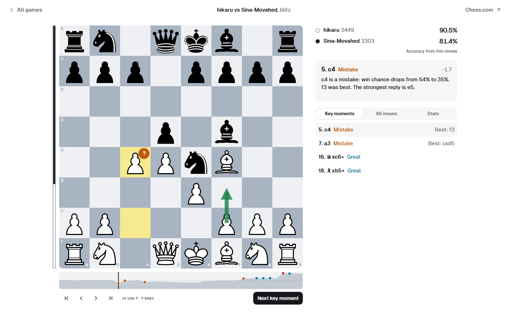
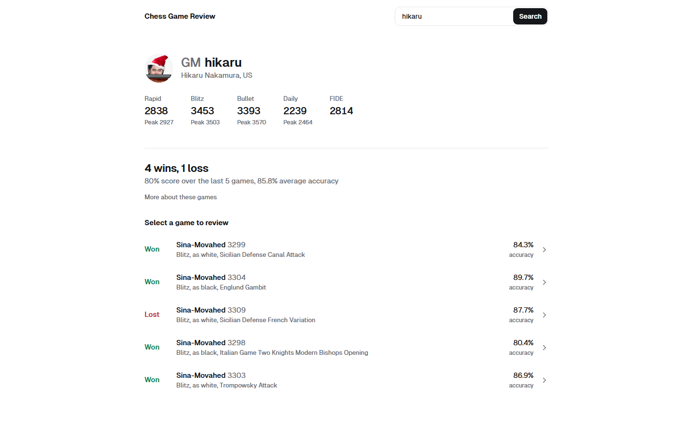
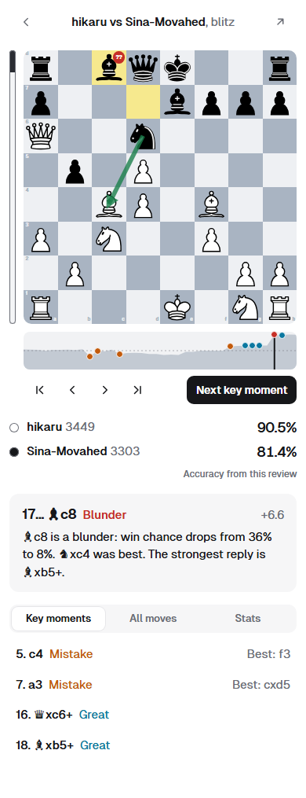

# Chess Game Review

**See where the game turned.** Enter any Chess.com username to see the player's Elo and last 5 games, then go through each game move by move with Stockfish.

There's no account or API key to set up, and no server doing the analysis. The engine runs in your browser.



## Features

- **Find any player:** search by username or paste a Chess.com profile link.
- **Elo at a glance:** current and peak ratings for rapid, blitz, bullet and daily, plus FIDE when listed.
- **Recent form:** wins, losses, score and average accuracy across the last 5 games.
- **Move-by-move review:** every move is rated, with a plain explanation and an arrow showing the better option.
- **Next key moment:** jump straight to the great moves, mistakes and blunders.
- **Evaluation graph:** see the shape of the game and select any point to go there.
- **Works everywhere:** light and dark themes, phone layouts, arrow keys and the browser's Back button.

| Player page | On a phone |
| --- | --- |
|  |  |

## Quick start

You need [Node.js](https://nodejs.org). The app was developed and tested on Node 24.

```bash
git clone https://github.com/hat1m11/Chess-Analysis.git
cd Chess-Analysis
npm install
npm start
```

Then open <http://localhost:3000>.

## How moves are rated

Chess.com's public API provides the moves but no verdicts on them, so Stockfish checks every position, searching to depth 14 and for at most 1.5 seconds. Each move is rated by how much win chance it gave up, with draws counting as half a win.

| Rating | Mark | Meaning |
| --- | --- | --- |
| Great | `!` | The engine's top move, and the only strong one. Simple recaptures don't count. |
| Best | `★` | The engine's top move |
| Excellent | `✓` | Lost under 2% |
| Good | `✓` | Lost 2% to 5% |
| Inaccuracy | `?!` | Lost 5% to 10% |
| Mistake | `?` | Lost 10% to 20% |
| Blunder | `??` | Lost 20% or more |

Win chance and move accuracy use the formulas [published by Lichess](https://lichess.org/page/accuracy), and game accuracy blends each player's mean and harmonic mean move accuracy.

> [!NOTE]
> These ratings and accuracy scores won't match Chess.com's exactly. Its own accuracy figure is shown under **Stats** when available. The fast search can also misjudge a few close moves, especially between very strong players.

## Hosting

The app is entirely static, so any static host can serve it from the root of a domain.

```bash
npm run build
```

Upload the resulting `dist` folder. On [Netlify Drop](https://app.netlify.com/drop), you can drag it straight onto the page.

## Development

```bash
npm test        # run the unit tests
npm run build   # create dist/ for hosting
```

There's no framework or bundler: the browser loads the code in `src/` directly.

```text
public/    The page and styles
src/
  app.js          Search, player page and navigation
  reviewView.js   Review screen
  review.js       Move ratings, accuracy and explanations
  engine.js       Runs Stockfish in a Web Worker
  analysis.js     Overview of recent games
  chesscom.js     Chess.com API client
tests/     Unit tests
scripts/   Static site build
server.js  Local development server
```

## Limitations

- Chess.com's API has no name search, so usernames must match exactly, though capitals don't matter.
- Move review covers standard chess only, not variants such as Chess960.
- Reviews aren't saved, so refreshing the page means analysing a game again.

## Credits

| Project | Used for | License |
| --- | --- | --- |
| [Chess.com Published-Data API](https://www.chess.com/news/view/published-data-api) | Players and games | See Chess.com's terms |
| [Stockfish](https://github.com/nmrugg/stockfish.js) | Game analysis | GPL-3.0 |
| [chess.js](https://github.com/jhlywa/chess.js) | Move parsing | BSD-2-Clause |
| [chessground](https://github.com/lichess-org/chessground) | Piece images | GPL-3.0-or-later |
| [Geist Sans](https://www.npmjs.com/package/@fontsource/geist-sans) | Typeface | OFL-1.1 |

This project isn't affiliated with Chess.com. Anyone distributing it must follow the GPL-3.0 terms that apply to Stockfish and chessground.
